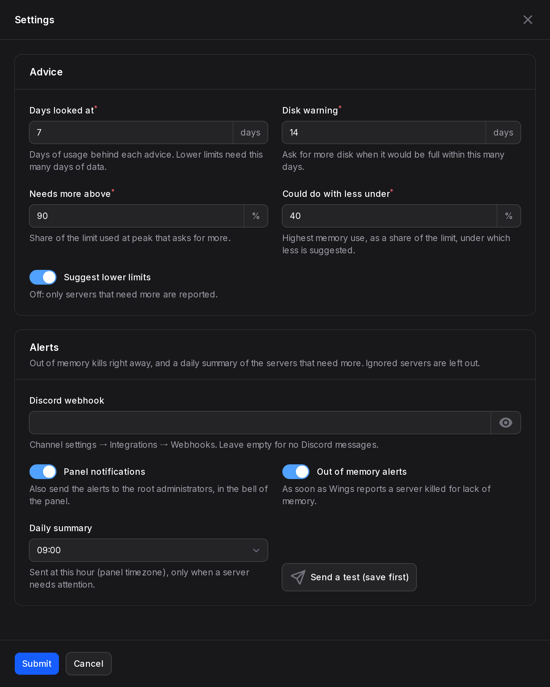

<p align="center">
  
</p>

<p align="center">
  <a href="https://github.com/MaitreAntho/pelican-resource-advisor/releases/latest"></a>
  
  
  <a href="LICENSE"></a>
</p>

<p align="center">
  <b>Stop guessing how much RAM, disk and CPU your servers need.</b><br />
  Resource Advisor watches every server of your <a href="https://pelican.dev">Pelican Panel</a> and tells you which ones need more, and which ones could do with less.
</p>

---

## ✨ Features

### 🚦 Advice for every server
A **Resource Advisor** page in the admin area lists every server with its advice: **Needs more**, **Could do with less**, **Right size** or **Still measuring**. Sort by advice, or filter to see only the servers that need attention. Export everything as CSV.

<p align="center"></p>

### 🗄️ Node overview
For every node: what the servers **reserve**, what they **really use at peak**, what is **left to hand out**, and how much you could **reclaim** by following the advice. Nodes handing out more than they have are shown in red.

### 🧠 Smart about memory
- A server above **90 %** of its memory at peak, or **killed for lack of memory** (reported by Wings), needs more.
- **Java servers** (Minecraft, Project Zomboid...) keep all the memory they are given, so a full graph means nothing: they are judged on out of memory kills only. No false alarms.
- **Limit changes are tracked**: after a change, only the hours measured with the new limit count. A crash at 2 GiB will not ask for more again once the server has 3 GiB.

### 💾 Disk forecast
The 7-day trend tells you **how many days are left** before the disk is full. Under 14 days, you get the advice before your users get the error.

### 📈 Usage graphs
Memory, disk and CPU over **24 hours, 7 days or 30 days**: hourly peak and average, the limit (with a step where it was changed) and a red mark at each out of memory kill. Hover a graph to read any hour.

<p align="center"></p>

### 🖱️ Apply in one click
The advised limits are filled in for you, change them if needed, with the space left on the node next to each field. **Every other limit is kept** (databases, allocations, backups) and the node applies the change right away.

<p align="center"></p>

### 🔔 Alerts
- **Out of memory kills** right away, as soon as Wings reports them.
- A **daily summary** of the servers that need more, at the hour you choose.
- On **Discord** (webhook) and/or in the **panel notifications** of the root administrators.

### 🙈 Ignore a server
Your own test server, a server you already know about: ignore it for 7 days, 30 days or until you stop it. Its advice stays visible, but it leaves the counters, the filter and the alerts.

### 🪶 Light and safe
- One request per node every 5 minutes, whatever the number of servers. Hourly summaries, kept 35 days.
- Lower limits are only suggested after a full week of data, with a safe margin. Until then the server shows the date the advice will be confirmed.
- Admins only: users never see this page. Root admins have full access; give other roles the **Resource Advisor → View** permission (and **Update** to apply limits and ignore servers) in **Admin → Roles**. Roles limited to some nodes only see their servers.
- Works with **SQLite, MySQL, MariaDB and PostgreSQL**. English and French included.

---

## 📦 Installation

**From the admin area (easiest)**
1. Open **Admin → Plugins** and click **Import from URL**.
2. Paste this link and confirm:
   ```
   https://github.com/MaitreAntho/pelican-resource-advisor/releases/latest/download/resource-advisor.zip
   ```
3. Click **Install** next to **Resource Advisor**.

**Manually**: download `resource-advisor.zip` from the [latest release](https://github.com/MaitreAntho/pelican-resource-advisor/releases/latest), extract it into the `plugins` folder of your panel (the folder must be named `resource-advisor`), then install it from **Admin → Plugins**.

The first measures arrive within 5 minutes. Advice appears after 12 hours of use for memory and CPU, and 24 hours for disk.

## ⚙️ Requirements

- Pelican Panel 1.0 or newer, with its scheduler running (it is, in the official Docker image and with the standard cron).
- Wings crash detection enabled (the default), so out of memory kills are counted.

## 🔧 Settings

Open **Admin → Plugins** and click the ⚙️ **Settings** button of Resource Advisor: thresholds, alerts, Discord webhook and the hour of the daily summary. Use **Send a test** after saving to check the alerts.

<p align="center"></p>

The same settings are environment variables in your panel's `.env`:

| Variable | Default | Meaning |
| --- | --- | --- |
| `RESOURCE_ADVISOR_WINDOW_DAYS` | `7` | Days of usage the advice looks at |
| `RESOURCE_ADVISOR_RETENTION_DAYS` | `35` | Days of samples kept |
| `RESOURCE_ADVISOR_INCREASE_THRESHOLD` | `0.9` | Share of the limit that means "needs more" |
| `RESOURCE_ADVISOR_DECREASE_THRESHOLD` | `0.4` | Peak share under which memory "could do with less" |
| `RESOURCE_ADVISOR_DISK_DAYS_WARNING` | `14` | Days before the disk is full that trigger the advice |
| `RESOURCE_ADVISOR_SUGGEST_DECREASE` | `true` | Also suggest lower limits |
| `RESOURCE_ADVISOR_DISCORD_WEBHOOK` | empty | Discord webhook for the alerts |
| `RESOURCE_ADVISOR_NOTIFY_ADMINS` | `false` | Also send the alerts as panel notifications to root administrators |
| `RESOURCE_ADVISOR_NOTIFY_OOM` | `true` | Alert as soon as a server is killed for lack of memory |
| `RESOURCE_ADVISOR_DIGEST_HOUR` | `9` | Hour of the daily summary (panel timezone), empty to turn it off |

Alerts are only sent once a channel is set (a Discord webhook, or the panel notifications).

## ❓ FAQ

**Will it change my servers by itself?**
No. It only gives advice. Limits change when an administrator clicks **Apply**.

**Why does my Minecraft server show 95 % memory and "Right size"?**
Java reserves the memory it is given, whatever the game needs. The plugin only asks for more when the server is actually killed for lack of memory.

**I raised a limit, why does the server show "Still measuring"?**
The advice only looks at the hours measured with the current limit. It comes back after 12 hours of use, and lower limits after a full week.

**Does it slow down the panel or the nodes?**
No. It asks each node once every 5 minutes for the stats Wings already keeps, and stores one row per server and per hour. The advice is computed once for all servers and cached until new data arrives.

## 🤝 Contributing

Issues and pull requests are welcome, especially translations in `lang/`.

## 📄 License

[MIT](LICENSE) © MaitreAntho
